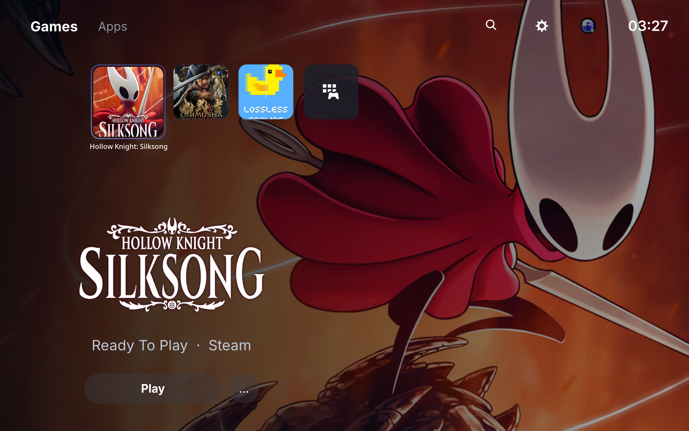
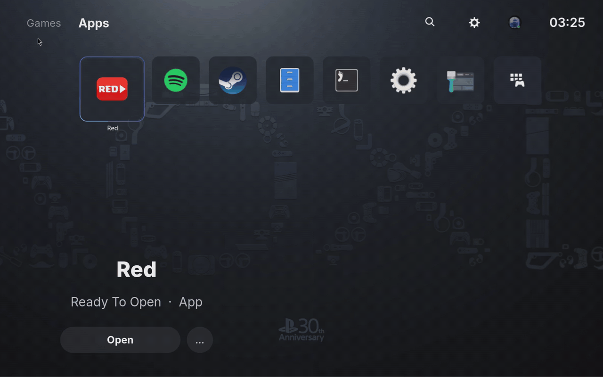
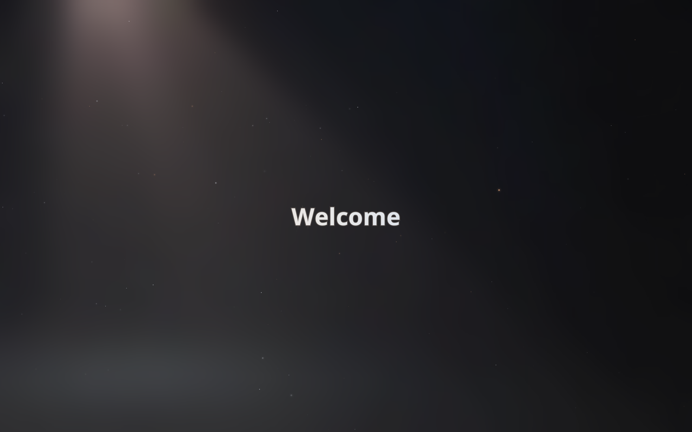
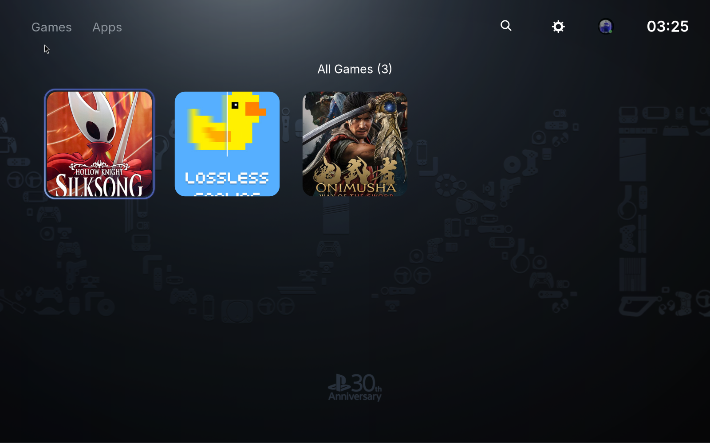
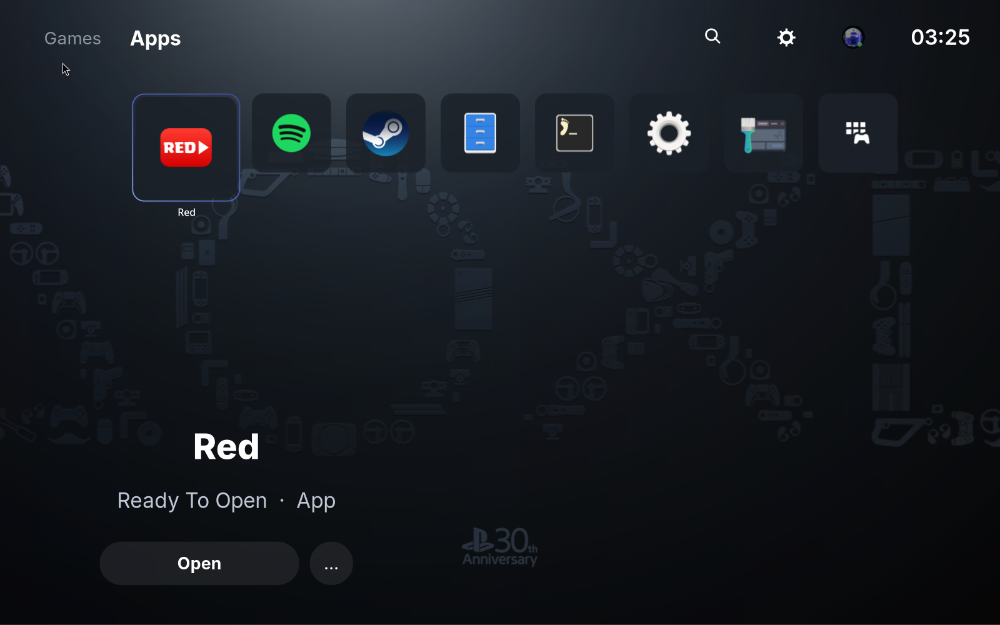
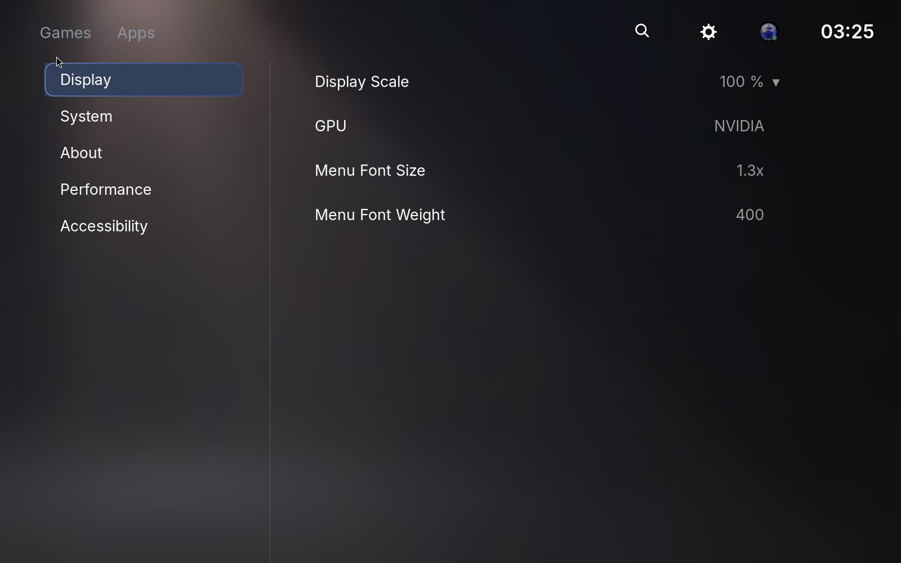
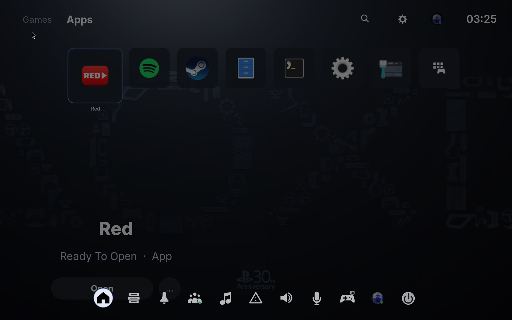

# PS5-WC: A PS5-like Wayland Compositor


**A controller-first Linux desktop with a console-style dashboard, built into a native Wayland compositor.**

PS5-WC uses Smithay for display, window, and input management. Games, Apps,
Settings, and Control Center are drawn by the compositor. It can start
directly from GDM, SDDM, or a Linux TTY, and it also has a nested preview mode.

[Install](#install) · [Demos and screenshots](#demos-and-screenshots) · [Controls](docs/CONTROLS.md) · [Troubleshooting](docs/TROUBLESHOOTING.md)



## Demos and screenshots

These demos were captured from the Rust build in a nested Wayland session.

### Welcome and Games


### Apps, Settings, and Control Center



Full-resolution MP4s are also available for download
([Welcome and Games](docs/media/welcome-and-games.mp4) ·
[Apps, Settings, and Control Center](docs/media/apps-and-control-center.mp4)).

| Welcome | Game Library |
| --- | --- |
|  |  |
| **Apps** | **Settings** |
|  |  |



## Install

Clone the repository into a directory owned by the user who will run PS5-WC.

```sh
git clone https://github.com/beastzy/PS5-WC.git
cd PS5-WC
./install.sh
```

The installer sets up dependencies, builds PS5-WC, and adds **PS5-WC** to
GDM and SDDM. Sign out and choose it in your login manager. Run
`./install.sh --dry-run` to preview the installation steps.

See [Installation and updates](docs/INSTALLATION.md) for supported
distributions, manual dependencies, and TTY and preview commands.

## What it includes

- Games and Apps carousels, a searchable library, pinning, and keyboard or
  controller navigation.
- Steam launch integration, fullscreen game windows, and an artwork
  transition while games start.
- Control Center with a window Switcher, audio and microphone controls,
  media playback controls, and screenshots.
- Game suspension and audio muting on Home, with Continue and Switcher
  resuming the same game.
- Native Wayland and XDG Shell applications, XWayland for X11 applications
  and games, and DRM/KMS output in a native session.
- Welcome and carousel animations, menu audio, and accessibility options
  such as reduced motion and high contrast.

## Documentation

| Guide | What it covers |
| --- | --- |
| [Installation and updates](docs/INSTALLATION.md) | Dependencies, session registration, preview, and removal |
| [Keyboard and controller controls](docs/CONTROLS.md) | Dashboard, Steam games, app switching, and captures |
| [Troubleshooting](docs/TROUBLESHOOTING.md) | Missing session, Steam, graphics, audio, and input |
| [Project layout and development](docs/DEVELOPMENT.md) | Rust source, assets, build commands, and preview rendering |

## Source and assets

PS5-WC is an independent project inspired by the PlayStation interface.
The vendored [Smithay and Anvil source](rust/LICENSE.txt) retains its MIT
license. Demo game artwork and bundled console-style media have separate
rights. Review those assets before redistributing them or making a public
mirror.
